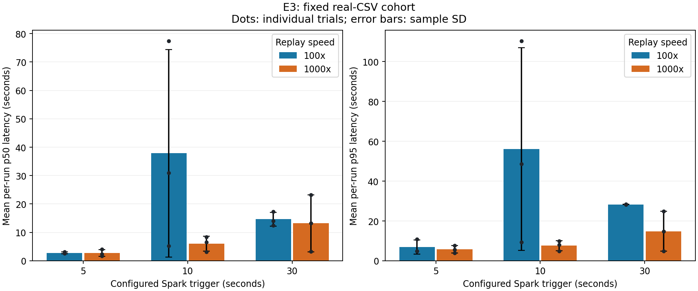
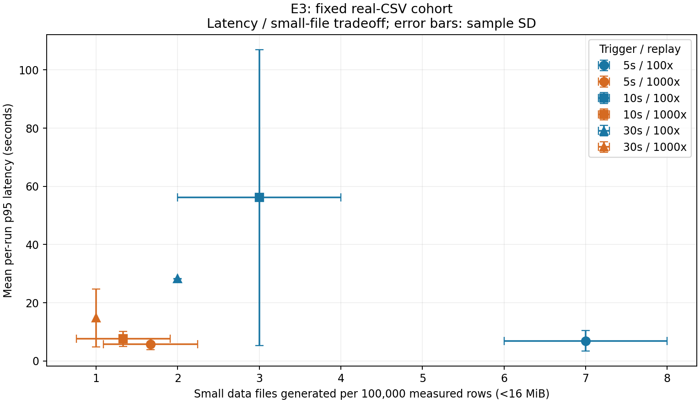

# E3: fixed real-CSV cohort

**18 measured trials; 3 per configuration. Read [ANALYSIS.md](ANALYSIS.md): two pacing misses at10s/100x are retained, so that cell does not isolate a controlled actual100x input rate.** All1.8M persisted rows and file counts passed the [independent audit](independent-audit.json).

Measured differences use Spark batch-start `ingested_at`, not Delta commit time. Signed negative differences are retained and counted. Warmup is excluded.

| Trigger s | Replay | n | p50 seconds mean ± SD | p95 seconds mean ± SD | Files mean ± SD | Pace misses |
|---:|---:|---:|---:|---:|---:|---:|
| 5 | 100x | 3 | 2.792 ± 0.283 | 6.911 ± 3.478 | 7.00 ± 1.00 | 0 |
| 5 | 1000x | 3 | 2.723 ± 1.209 | 5.758 ± 1.880 | 1.67 ± 0.58 | 0 |
| 10 | 100x | 3 | 37.885 ± 36.541 | 56.138 ± 50.855 | 3.00 ± 1.00 | 2 |
| 10 | 1000x | 3 | 6.022 ± 2.603 | 7.586 ± 2.565 | 1.33 ± 0.58 | 0 |
| 30 | 100x | 3 | 14.625 ± 2.483 | 28.315 ± 0.081 | 2.00 ± 0.00 | 0 |
| 30 | 1000x | 3 | 13.201 ± 10.000 | 14.794 ± 10.000 | 1.00 ± 0.00 | 0 |

These are means of per-run percentiles, not pooled event percentiles. Replay durations differ because every trial uses the same fixed source cohort.

