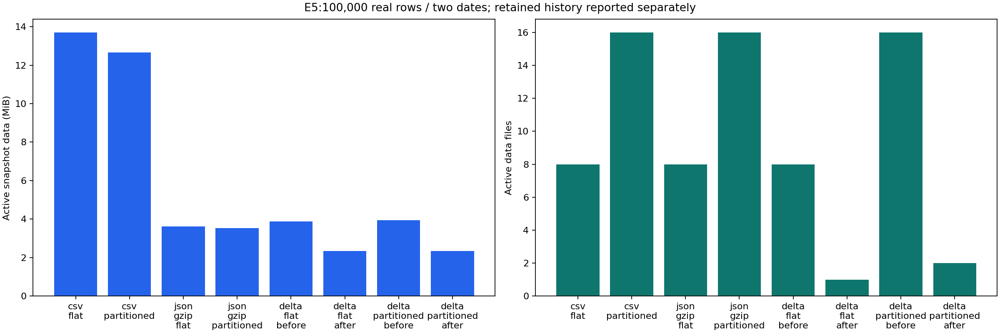
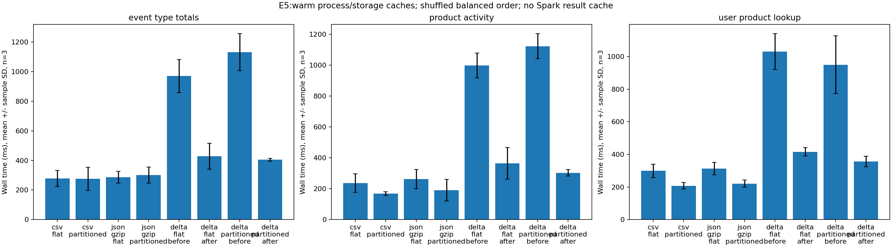

# E5 — PASS: format, partitioning and OPTIMIZE ZORDER

[Nhận xét và kịch bản chương6–7](ANALYSIS.md) · [Bảng/biểu đồ để đưa vào báo cáo](publication/README.md)

Measured on **100,000 real rows**, 50,000/date for 2019-11-01/02.
Selection: first N source records per date, original timestamps and multiplicities.
Same nine typed C1 columns plus derived `event_date` in every format; no synthetic metadata.

| Variant | Active MiB | Active files | Physical MiB incl. history | Q1 median ms | Q2 median ms | Q3 median ms |
|---|---:|---:|---:|---:|---:|---:|
| csv_flat | 13.706 | 8 | 13.706 | 249.8 | 249.2 | 311.3 |
| csv_partitioned | 12.657 | 16 | 12.657 | 239.3 | 162.5 | 211.6 |
| json_gzip_flat | 3.610 | 8 | 3.610 | 290.6 | 279.2 | 297.8 |
| json_gzip_partitioned | 3.539 | 16 | 3.539 | 306.1 | 150.3 | 217.5 |
| delta_flat_before | 3.869 | 8 | 6.231 | 994.4 | 1044.0 | 1021.9 |
| delta_flat_after | 2.349 | 1 | 6.231 | 385.3 | 314.9 | 407.7 |
| delta_partitioned_before | 3.937 | 16 | 6.316 | 1067.6 | 1117.8 | 860.5 |
| delta_partitioned_after | 2.354 | 2 | 6.316 | 403.2 | 312.8 | 341.8 |

Q1:daily event types/distinct users. Q2:top product activity/revenue (decimal arithmetic).
Q3:exact user/product lookup. All query results match the same source baseline;
all eight datasets pass exact typed multiset equality. **72 trials**, three per
variant/query, with one untimed warmup for each cell. See [comparison.csv](comparison.csv),
[query-summary.csv](query-summary.csv) and [raw trials](trials/).

## Interpretation and limits

- Active snapshot sizes/file counts are logical data footprints. Physical totals
  include retained old Delta files and transaction metadata. The two versions
  of a Delta table share one physical directory: do not sum their physical totals.
- Eight writer tasks; partitioned output can have more files than flat output.
  Delta uses Snappy Parquet; JSON is newline JSON gzip; CSV is uncompressed.
- Delta before/after versions are pinned and queried in the same randomized
  measurement window. OPTIMIZE ZORDER(user_id,product_id) is a combined treatment;
  this small cohort does not establish the independent benefit of ZORDER.
- Wall time includes reader/view creation, planning, execution and result
  collection, excludes validation/metric capture. Spark DataFrame/result caches
  are cleared. JVM, OS and MinIO caches are warm; these are not cold IO timings.
- [pruning.csv](pruning.csv) records runtime selected files and full file sizes,
  not actual IO bytes. [plans/](plans/) contains EXPLAIN FORMATTED for all24 cells.
  Partitioned variants require nonempty event_date filters and fewer selected
  than total active files on every trial. Data skipping is distinct from pruning.
- All old files and time-travel versions are retained with 30-day table retention.
  No VACUUM/deletion is part of E5. First-N rows on two dates are a controlled
  cohort; no extrapolation to full-month or multi-host production throughput.

## Reproduce and provenance

From repo root: `bash benchmarks/e5_storage.sh` or `make bench-e5`.
Each invocation creates new storage/result scope and retains diagnostics.
[manifest.json](manifest.json) binds cohort selection/hashes, queries, lookup IDs,
settings and source URI. [variants.json](variants.json) records exact versions,
OPTIMIZE metrics and snapshot paths; [snapshots/](snapshots/) lists active and
physical files. [workload.json](workload.json) contains the scanned source prefix
hash and actual per-day bounds. Source cohort: [cohort.csv](cohort.csv).

Method references: [Delta OPTIMIZE/ZORDER](https://docs.delta.io/optimizations-oss/),
[Spark 3.5.3 scan metrics](https://github.com/apache/spark/blob/v3.5.3/sql/core/src/main/scala/org/apache/spark/sql/execution/DataSourceScanExec.scala).
