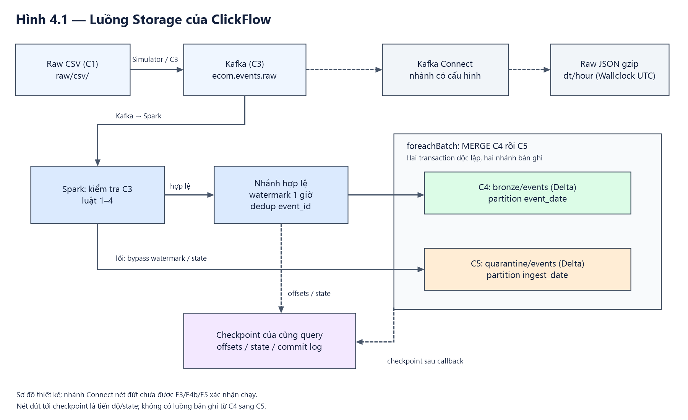

# Chương 4 — Thiết kế tầng Storage (phần TV3)

*Mục4.3 dành cho Storage khi ghép chương kiến trúc chung với TV2. Phạm vi
mô tả là code/config và minh chứng có tại ngày 02/11/2026; C4/C5 phiên bản 1.0.0
đang `review_ready`, phiếu duyệt nhóm vẫn `pending`.*

## 4.3. Thiết kế lưu trữ và kiểm soát chất lượng

### 4.3.1. Kiến trúc và các vùng dữ liệu

Storage dùng MinIO bucket `lake`, Spark master và hai worker. Kafka topic
`ecom.events.raw` cung cấp message C3 cho một query Structured Streaming.
Spark chuẩn hóa/kiểm tra trước khi định tuyến đến hai bảng Delta. Hình 4.1
mô tả luồng thiết kế; nhánh Connect được biểu diễn riêng vì cấu hình sẵn có
không đồng nghĩa đã được kiểm chứng trong các lượt E3/E4b/E5.



*Nguồn: tác giả tổng hợp từ [cấu hình](../configs/pipeline.yaml),
[writer](../src/storage/stream_to_bronze.py) và
[Connect config](../configs/connect/s3-sink.json). Đây là sơ đồ thiết kế,
không phải ảnh chụp một lần chạy. C4 và C5 nhận hai nhánh bản ghi khác nhau;
thứ tự MERGE nằm trong callback, không phải luồng dữ liệu từ C4 sang C5.
[Mã Mermaid](figures/ch04_storage_flow.mmd).*

| Prefix/bảng | Dữ liệu và cách tổ chức | Trạng thái/phạm vi |
|---|---|---|
| `raw/csv/` | CSV Kaggle gốc, C1 | Nguồn tháng và CSV upload cho xử lý lại |
| `raw/ecom.events.raw/` | JSON gzip theo cấu hình Kafka Connect, `dt/hour` UTC Wallclock | Nhánh lưu raw đã có cấu hình; không suy ra đã chạy thành công từ benchmark Storage |
| `bronze/events/` | Delta C4, partition `event_date` UTC | Đích Kafka chuẩn hóa cho Processing |
| `quarantine/events/` | Delta C5, partition `ingest_date` UTC | Message lỗi và lý do chính |
| `_checkpoints/kafka_to_delta_watermark_v1/` | Offset log, commit log và state của query | Phục hồi query tương thích cùng nguồn/đích |

`bronze/sample_events/` dành cho chế độ batch mẫu. Các benchmark dùng scope
riêng dưới `_checkpoints/e3/`, `_checkpoints/e4b/`, `_checkpoints/e5/` và topic
thử khi cần; kết quả trên chúng không được trình bày như số dòng production.
Spark đọc trực tiếp Kafka, không cần đợi Connect ghi JSON gzip rồi mới nạp bronze.

### 4.3.2. Contract và biểu diễn kiểu dữ liệu

C1 có chín cột: `event_time`, `event_type`, `product_id`, `category_id`,
`category_code`, `brand`, `price`, `user_id`, `user_session`. C3 bổ sung
`event_id`, `source_file`, `produced_at`. Kiểu ID là signed 64-bit `bigint`;
`category_id` không được đọc qua `float` vì có thể mất chữ số.

| Bảng | Các cột ngoài chín trường C1 | Partition | Số cột vật lý |
|---|---|---|---:|
| C4 bronze | `event_id:string`, `kafka_partition:int`, `kafka_offset:bigint`, `produced_at:timestamp`, `ingested_at:timestamp` | `event_date:date` | 15=9+5+1 |
| C5 quarantine | `payload:string`, `error_reason:string`, `kafka_partition:int`, `kafka_offset:bigint`, `ingested_at:timestamp`; không mang chín cột C1 dạng tách trường | `ingest_date:date` | 6=5+1 |

C4 có **14 cột dữ liệu**, chưa tính partition. `source_file` thuộc C3, không
phải cột thứ 16 của C4. C5 có **5 cột dữ liệu**, chưa tính partition. Hai cột
partition được Delta khai báo nullable trong schema hiện có, nhưng invariant
pipeline yêu cầu giá trị không null và được tính đúng theo UTC. Chi tiết ở
[C4](../contracts/bronze_events.yaml), [C5](../contracts/quarantine_events.yaml)
và [bản bàn giao](../docs/contracts-c4-c5-handoff.md).

`produced_at` ở C4 cho phép null; nhánh Kafka hiện kiểm tra timestamp C3 hợp lệ.
Chế độ sample dùng bảng riêng với `produced_at=null`, Kafka partition/offset=-1
và ID suy ra từ chín trường C1. Các ngoại lệ này không được trộn vào bảng Kafka
chính. `ingested_at` do `current_timestamp()` trong query tạo ở đầu micro-batch;
dòng đã commit đầu tiên được giữ nguyên khi MERGE gặp lại ID.

### 4.3.3. Luật1–4 và định tuyến lỗi

`quality_rules.py` kiểm tra chuỗi trước Spark coercion, rồi mới tạo JSON chuẩn
hóa để parse theo schema. ID kiểu số thực hoặc boolean không được tự ép thành
bigint. Chỉ một lý do lỗi có mức ưu tiên cao nhất được chọn cho mỗi message.

| Luật | Kiểm tra chính | error_reason |
|---|---|---|
| 1 | JSON không parse được, không phải object, key trùng/không hợp lệ, sai cấu trúc hoặc kiểu C3 | `parse_error` |
| 2 | `event_time` thiếu/null, timestamp hỏng hoặc ngoài tháng của `source_file` | `bad_event_time` |
| 3 | `event_type` không thuộc view/cart/purchase | `bad_event_type` |
| 4 | `product_id` hoặc `user_id` thiếu/null; sau đó kiểm tra giá âm | `missing_id`, rồi `negative_price` |

Ví dụ, `product_id=null` và `price=-1` cho `missing_id`; còn ID dạng chuỗi sai
kiểu đã bị bắt bởi luật 1. `category_id` thiếu/sai kiểu cũng thuộc luật 1.
`category_code`, `brand`, `user_session` null là hợp lệ. C3 có `source_file`
theo tháng, nên khoảng nguồn của `2019-Nov.csv` là tháng11/2019, không chỉ ngày
đang demo. Một message nhiều lỗi không làm tăng nhiều dòng quarantine.

C5 giữ nguyên chuỗi UTF-8 sau khi Kafka value được cast sang string; không
serialize lại object để thay `payload`. Tombstone có thể có payload null.
`ingest_date` lấy từ thời điểm nhận lỗi vì `event_time` có thể không sử dụng
được. Nhánh lỗi không đi qua watermark/dedup của nhánh hợp lệ.

### 4.3.4. Luật5: state và uniqueness bền

Nhánh hợp lệ thực hiện:

```python
valid.withWatermark('event_time', '1 hour') \
     .dropDuplicatesWithinWatermark(['event_id'])
```

Duplicate trong state bị bỏ và đếm `duplicates_dropped`, không ghi C5. Dòng
hợp lệ quá watermark có thể bị loại riêng và đếm `late_records_dropped`.
Để giữ uniqueness cho dữ liệu còn tới sink sau khi state hết hạn, writer dùng
insert-only MERGE theo `event_id` trên toàn bảng C4. Đây là hai lớp bảo vệ có
phạm vi khác nhau; thiết kế không dựa vào watermark như ràng buộc UNIQUE.

Writer giữ dòng đã commit đầu tiên. Nếu thấy cùng ID nhưng khác một trong
chín giá trị C1, nó giữ dòng cũ và phát cảnh báo; Kafka/producer/ingestion
metadata không tham gia so sánh xung đột. Duplicate đã bị state loại không
còn tới sink để kiểm tra xung đột nội dung. C5 MERGE theo cặp partition/offset
trong **một topic đã bind**: hai offset khác nhau là hai message khác nhau.

### 4.3.5. Micro-batch, checkpoint và phục hồi

Cấu hình hiện tại: trigger10 giây, `maxOffsetsPerTrigger=500000`, watermark1 giờ,
`startingOffsets=earliest` cho lần đầu, `failOnDataLoss=true`. Một driver ghi
cặp bảng tại một thời điểm. Nhánh hợp lệ sau dedup được union với nhánh lỗi,
đi vào một `foreachBatch`; callback persist batch, MERGE C4 rồi C5 và cập nhật
counter sau commit. Spark xác nhận batch trong checkpoint sau khi callback trả về.

Hai MERGE là hai transaction độc lập. Nếu lỗi xảy ra giữa chúng, reader có
thể tạm thấy C4 tiến trước C5. Khi chạy lại cùng checkpoint, batch chưa xác
nhận được replay; các MERGE idempotent ngăn chèn lại dòng đã ghi. Bảo đảm hội
tụ phụ thuộc ID ổn định, cùng source/targets, checkpoint còn dùng được, dữ liệu
nguồn còn đọc lại được và chính sách một writer; không gọi đây là atomic
commit chung giữa Kafka, hai bảng Delta và checkpoint.

Marker `_clickflow_stream_identity.json` bind topic/brokers, đường dẫn đích,
fingerprint C3, version C4/C5; checkpoint thêm operator, keys, watermark,
routing và shuffle partitions. Writer từ chối checkpoint cũ không có binding
hoặc layout không tương thích. Thay state plan cần kế hoạch migration hoặc
checkpoint/đích phù hợp, không xóa checkpoint để ép bỏ qua kiểm tra.

### 4.3.6. Partition và giao diện truy vấn

C4 chia theo `to_date(event_time)` UTC vì truy vấn Processing thường theo
ngày sự kiện. C5 chia theo `to_date(ingested_at)` UTC để truy xuất lỗi theo
ngày xử lý. Không suy source event-date từ `ingest_date` khi đối soát.

```sql
SELECT event_type, COUNT(*) AS rows, COUNT(DISTINCT user_id) AS users
FROM delta.`s3a://lake/bronze/events/`
WHERE event_date = DATE '2019-11-01'
GROUP BY event_type;
```

Bộ lọc trực tiếp trên partition là giao diện được khuyến nghị trong
[sample_queries.sql](../queries/sample_queries.sql). Bằng chứng pruning cần
cả `PartitionFilters` trong plan và số file runtime được chọn thấp hơn tổng
active; tổng kích thước các file được chọn không phải bytes IO thực tế.
[SP3](references_storage.md#sp3) Không chia partition theo user/product vì sẽ
tạo nhiều nhóm nhỏ; hai cột này được dùng cho ZORDER thay vì partition key.

### 4.3.7. Bảo trì, metrics và đối soát

`maintenance.py` chỉ OPTIMIZE partition trước mốc đóng `closed_before`,
ZORDER `(user_id, product_id)`, target128 MiB; log file/bytes trước và sau.
VACUUM mặc định DRY RUN. Chính sách dự án: time travel30 ngày/720 giờ, khôi phục
stream tối đa7 ngày/168 giờ, cửa sổ transaction24 giờ. Retention phải bao phủ
time travel và lớn hơn hai cửa sổ còn lại; kiểm tra an toàn không bị tắt.
Đây là chính sách cấu hình, không phải bằng chứng đã chạy stream liên tục 30 ngày.

Metric sink ghi số dòng thực chèn sau commit; counter driver reset khi restart.
`StreamingQueryListener` theo dõi progress, duplicate-state và late drops.
Progress input có thể bị đếm lại do nhiều action của `foreachBatch`, nên không
dùng nó thay audit nguồn/đích. `duplicates_ignored` của replay là lượt xử lý,
không tự động là số thông điệp nguồn bị loại.

`reconcile.py` pin version bảng và đối soát cohort đã đóng. Cân bằng theo ngày
gồm source=bronze+quarantine+state duplicates+late drops+durable source duplicates.
Các đại lượng đều phải cùng phạm vi và đếm thông điệp nguồn, tránh cộng lại
lượt retry. Mọi dòng C5 có lý do `parse_error` hoặc `bad_event_time` đều cần
mapping Kafka offset→ngày nguồn từ bằng chứng, kể cả khi chuỗi timestamp vẫn parse được;
thiếu audit hoặc còn dòng không gán được ngày thì `match=false`, không giả
định mọi counter bằng 0. Kết quả xuất sáu trường:
`event_date,rows_source,rows_bronze,rows_quarantine,duplicates_dropped,match`.

### 4.3.8. Minh chứng E3, E4b và E5

**E3 — trigger và file nhỏ.** Mỗi trial dùng 100.000 dòng thật, ba trial/cấu hình,
18 trial tổng 1,8 triệu dòng đo. Bảng 4.1 lấy trực tiếp từ
[summary.csv](../benchmarks/results/e3-3eb2dde82e154bf09283424977d28cf6/summary.csv).

| Trigger(s) | Target replay | p95(s), mean±SD | File nhỏ, mean±SD | Pace miss/3 |
|---:|---:|---:|---:|---:|
| 5 | 100x | 6,911±3,478 | 7,00±1,00 | 0 |
| 10 | 100x | 56,138±50,855 | 3,00±1,00 | 2 |
| 30 | 100x | 28,315±0,081 | 2,00±0,00 | 0 |
| 5 | 1000x | 5,758±1,880 | 1,67±0,58 | 0 |
| 10 | 1000x | 7,586±2,565 | 1,33±0,58 | 0 |
| 30 | 1000x | 14,794±10,000 | 1,00±0,00 | 0 |

E3 đo hiệu `ingested_at-produced_at` đến đầu micro-batch, **chưa gồm Delta
commit**. Bảng là mean của percentile từng trial và sample SD, không phải
percentile gộp/CI. Tại target 100x, hai cell đạt pace đầy đủ cho thấy trigger 5 s
có nhiều file hơn và p95 thấp hơn 30 s. Cell 10 s/100x có hai pacing miss, nên không
dùng để suy tác động riêng của trigger tại actual 100x. Cohort 1000x chỉ phát
khoảng 3,452 giây; pha đầu vào ảnh hưởng mạnh. Cả 48 file sau warmup đều <16 MiB.
[Phân tích E3](../benchmarks/results/e3-3eb2dde82e154bf09283424977d28cf6/ANALYSIS.md).

**E4b — lỗi driver.** Khi Delta có 6.000 dòng nhưng checkpoint mới xác nhận
1.000, controller gửi SIGKILL tới đúng driver đang nhận dữ liệu; producer vẫn
chạy và đã ACK 7.123 message. Recovery giữ query ID/checkpoint binding, tạo run ID
mới. Batch có 5.000 dòng đã ghi được replay với 0 insert, 5.000 lượt MERGE bỏ qua.

| Event-date nguồn thử | Source | Bronze | Quarantine | match |
|---|---:|---:|---:|---|
| 2019-11-01 | 10027 | 10027 | 0 | true |
| 2019-11-02 | 9973 | 9973 | 0 | true |

Đối soát và so sánh giá trị xác nhận 20.000 ID duy nhất, 0 mất/thừa/sai trường;
cả 15 trường của 6.000 dòng trước kill giữ nguyên. E4b dùng 20.000 dòng từ mẫu 100.000 dòng với
timestamp **đã dịch qua hai ngày**, toàn bộ là dữ liệu hợp lệ. Nó không kiểm
chứng lỗi broker, C5 hỗn hợp hay transaction chung nhiều bảng. Counter 5.000
lượt replay không được trừ thêm vào 20.000 thông điệp nguồn.
[Nguồn E4b](references_storage.md#e4b).

**E5 — định dạng và layout.** Cohort khác E4b: 100.000 dòng timestamp gốc, 50.000 dòng/ngày
01–02/11/2019. Tám cấu hình dùng cùng chín cột C1+event_date; ba truy vấn có
ba lần/cell, tổng 72 trial, mọi kết quả và multiset đều khớp.

| Cấu hình | Active MiB | Active files | Q1/Q2/Q3 median(ms) |
|---|---:|---:|---|
| CSV flat | 13,706 | 8 | 249,8 / 249,2 / 311,3 |
| CSV partitioned | 12,657 | 16 | 239,3 / 162,5 / 211,6 |
| JSON gzip flat | 3,610 | 8 | 290,6 / 279,2 / 297,8 |
| JSON gzip partitioned | 3,539 | 16 | 306,1 / 150,3 / 217,5 |
| Delta flat trước | 3,869 | 8 | 994,4 / 1044,0 / 1021,9 |
| Delta flat sau | 2,349 | 1 | 385,3 / 314,9 / 407,7 |
| Delta partitioned trước | 3,937 | 16 | 1067,6 / 1117,8 / 860,5 |
| Delta partitioned sau | 2,354 | 2 | 403,2 / 312,8 / 341,8 |

Q1: daily event types/users; Q2: top product activity/revenue; Q3: user/product
lookup. Nguồn [comparison.csv](../benchmarks/results/e5-e385de717a4a4bfd8994c96ad3906ce6/comparison.csv),
MiB=2^20bytes. Delta partitioned giảm 16→2 file; 36/36 trial partitioned chứng minh
pruning (8/16 file trước, 1/2 file sau). OPTIMIZE và ZORDER được áp dụng đồng thời.
Physical footprint Delta flat/partitioned vẫn 6,231/6,316 MiB do giữ lịch sử;
hai version cùng bảng chia sẻ physical directory, không cộng trùng chúng.

CSV/JSON nhanh hơn Delta trong cohort nhỏ này. Wall time gồm reader/view,
planning, execute và collect; JVM/OS/MinIO cache warm, không cache kết quả Spark.
Không suy rộng thành ưu thế định dạng trên toàn tháng hoặc multi-host. Các
benchmark giải thích đánh đổi của thiết kế; không tự thay trigger mặc định 10 s
hay chứng minh một cấu hình tối ưu toàn cục. Bảng/biểu đồ chi tiết dành chương 6–7
nằm ở [bản publication E5](../benchmarks/results/e5-e385de717a4a4bfd8994c96ad3906ce6/publication/README.md).
